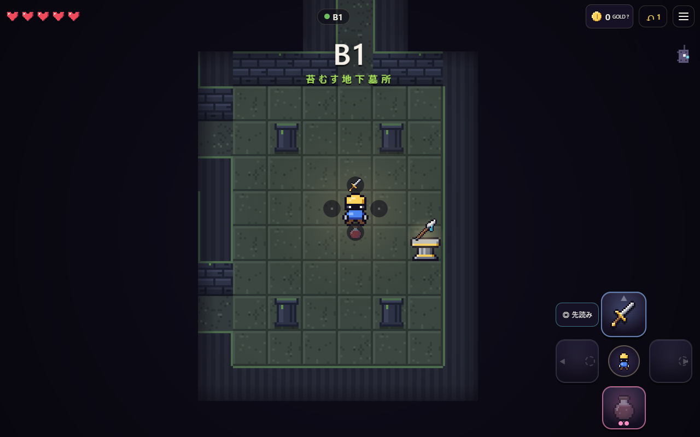

# FOURWARD

**その一歩が、武器になる。**

上下左右の4方向それぞれに装備を割り当てる、ターン制ダンジョン探索RPGです。
方向キーを押すと、その方向に**進むこと自体が攻撃・防御・魔法・回復**になります。
「どこへ行きたいか」と「何を発動したいか」を同時に考えながら、BSP法で自動生成される9階層のダンジョンを降り、最下層の「四方の番人」を倒すとクリアです。



---

## 起動方法

### ブラウザですぐ遊ぶ
**https://shioa2006-game.github.io/FOURWARD/** を開いてください（PC・スマホどちらでも）。

### ダウンロードして遊ぶ（インストール不要）
**`dist/index.html` をダブルクリック**してください。ブラウザで開くだけで遊べます（1ファイル完結・ネット接続不要）。
Chrome / Edge / Safari / Firefox の最新版で動作します。

### スマートフォンで遊ぶ
PCと同じWi-Fiにつないだスマホから遊べます（Node.js 22.18 以上が必要です）。

```bash
npm install
```

```bash
npm start
```

ターミナルに表示される `(phone) http://192.168.x.x:5173/` をスマホのブラウザで開いてください。
（`dist/index.html` を任意の静的ホスティングに置いても動きます。）

### 開発用コマンド
| コマンド | 内容 |
|---|---|
| `npm run build` | `dist/index.html` を再ビルド（esbuild で1ファイルに同梱） |
| `npm run dev` | 変更を監視して自動ビルド＋ローカルサーバー（ポート5173） |
| `npm test` | 単体テスト・プロパティテスト（ダンジョン生成、戦闘ルール、予告の正確さ） |
| `npm run typecheck` | TypeScript の型検査 |
| `npm run sim` | ボットによる自動プレイ（不変条件の検査・詰み検出・難易度統計） |
| `npm run e2e` | 実ブラウザ（Chrome）でのPC・スマホ操作のE2Eテスト（要ビルド） |

---

## 操作方法

| | PC | スマートフォン |
|---|---|---|
| 移動＝装備の発動 | 矢印キー / WASD | 画面下の十字ボタン（ボタンの絵が、その向きの装備）／マップをスワイプ |
| 連続移動 | 押しっぱなし（敵が見えていない時だけ） | ボタン長押し（同上） |
| 装備の説明 | 十字ボタンにマウスを乗せる | 中央の主人公ボタン／主人公をタップ |
| 先読み（行動せず比較） | P → 方向キー、または Shift＋方向キー | 「◎ 先読み」→ 十字ボタン |
| 先読みを実行／取り消し | Enter / Space で実行、Esc で取り消し | 「この方向へ」／「閉じる」 |
| GOLD・★強化の説明 | 右上のGOLD／マップ上の金床をクリック | 右上のGOLD／金床をタップ |
| 敵の情報・攻撃範囲 | 敵をクリック | 敵をタップ |
| 1手戻す（各階1回） | Z / Backspace / 右上の ↶ | 右上の ↶ |
| 最初からやり直す | タイトルの「↺ リセット」（つづきを消してB1から） | 同左 |
| メニュー | Esc / 右上のボタン | 右上のボタン |
| 消音 | M | メニュー内 |
| 決定 | Enter / Space | タップ |

---

## ゲームの概要（遊び方の早見表）

- **方向を押す＝その向きの装備を使う。** 通常は1ターン進みます。壁へ押すと、その場で「構え」（1ターン待つ）。先読みでの比較や、GOLD不足などで拒否された操作ではターンは進みません。
- **初めてなら「◎ 先読み」から。** 方向を選び、水色の◇（移動先）と金色の▧（攻撃・効果）を比べ、「この方向へ」で実行します。橙の点線は予約爆発。赤い点線が出た時は敵に押される等した後の位置です。被ダメージは反撃まで含みます。
- **赤いタイル**は敵の攻撃範囲。そこで手番を終えると攻撃されます（点の数＝ダメージ）。オレンジの数字は、その数のターン後に爆発。
- **十字ボタンの左上**＝あなたに起きること（−1など）、**右上**＝相手に起きること（ドクロ＝倒せる）。押す前に結果が分かります。
- **台座**を押すと、**押した向きのスロット**にその装備が入り、元の装備は台座に残ります。同じ装備なら★に強化。檻に入った台座は、その部屋の敵を全滅させると開きます。
- **回復**：薬瓶（各階2回）、階段で＋1、部屋の敵を全滅させると出るハート、番人の階の泉。
- **GOLD**はB2・B5・B8の金床で使用。費用は順に4・6・8 GOLD、金床1か所につき1回。金床へ押した方向の装備を★にします。★は数値の一律上昇ではなく、剣なら撃破時の連続行動、盾なら三方向防御などの特殊効果です。装備カードで個別の効果を確認できます。
- **階段**で次の階へ（＋1回復）。階段では装備を自由に並べ替えられます。
- B3・B6・B9 には番人（ボス）がいます。B9の「四方の番人」を倒すとクリア。死んでもゾーンの最初（B4・B7）から再挑戦できます。

装備は10種類（剣・槍・斧・鎚・炎の杖・氷の杖・盾・薬瓶・疾風靴・爆弾袋）。それぞれ「進んでから斬る」「その場で撃つ」「薙いでから進む」など、**進み方そのもの**が違います。

序盤のヒントは遭遇した状況に応じて1つずつ表示され、閉じるか次の行動をすると既読になります。同じブラウザでは繰り返し表示されません。いつでもメニューの「？」からルールを見直せます。自分で開いた装備・敵・台座の説明は時間で消えず、マップの空白を押して閉じられます。

詳しい設計は [GAME_DESIGN.md](GAME_DESIGN.md)、テスト結果は [TEST_REPORT.md](TEST_REPORT.md) を参照してください。

---

## ファイル構成

```
dist/index.html        ← 遊ぶためのファイル（ビルド済み・1ファイル）
src/
  core/                ← ゲームロジック（DOMに依存しない純粋なTypeScript）
    dungeon.ts         BSPダンジョン生成と到達可能性の検証
    floor.ts           フロアへの敵・台座・宝箱などの配置
    engine.ts          ターン進行、予告（プレビュー）、脅威マップ
    items.ts           10種の装備
    ai.ts              敵の攻撃範囲と行動、番人
    world.ts           ダメージ・吹き飛ばし・爆発などの共通ルール
    content.ts         装備・敵・フロアのデータ
  render/              ← Canvas描画（ピクセルアート、エフェクト、霧、ミニマップ）
  ui/                  ← HUD・十字パッド・画面遷移・入力
  audio/               ← WebAudioで合成した効果音と環境音楽
tests/                 ← node:test による単体・プロパティテスト
tools/                 ← ビルド、サーバー、自動プレイボット、E2E、テキスト版プレイハーネス
```

画像・音声ファイルは使っていません。ドット絵はすべてコード内の16×16の文字列データ、音はWebAudioで合成しています。
